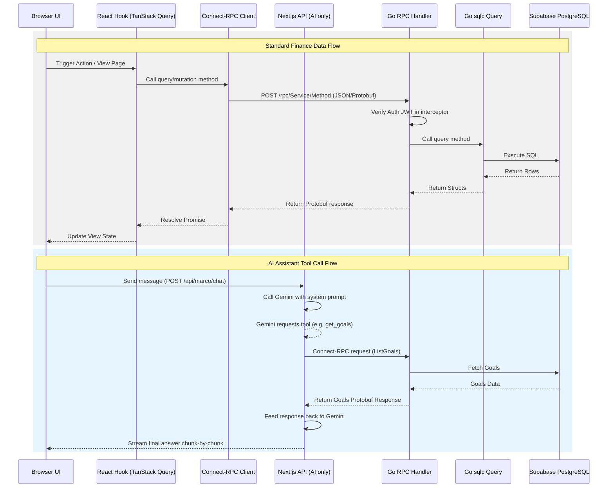

# Vasoli Architecture

Vasoli is designed with a clear, performance-oriented architectural boundary between the frontend presentation/AI orchestration layer (Next.js) and the finance business logic engine (Go Connect-RPC).

## Architectural Overview

```
┌─────────────────────────────────────────────────────────────┐
│                    CLIENT (Browser)                          │
├─────────────────────────────────────────────────────────────┤
│  Pages (Thin Routing Layer)                                 │
│  └─ src/app/(app)/*/page.tsx                                │
│                                                              │
│  Components                                                  │
│  ├─ src/components/ui/ (Radix/Neobrutalist primitives)       │
│  └─ src/components/app/ (Feature components)                │
│                                                              │
│  Hooks (TanStack Query + Connect-RPC client wrappers)       │
│  └─ src/lib/hooks/use-*.ts                                  │
│                                                              │
│  State (UI State Only)                                       │
│  └─ src/lib/stores/ (Zustand client-side state)             │
└─────────────────────────────────────────────────────────────┘
                            │
                            │ HTTP (Connect / gRPC-Web)
                            ▼
┌─────────────────────────────────────────────────────────────┐
│                    SERVER (Next.js Node)                     │
├─────────────────────────────────────────────────────────────┤
│  AI Orchestration & Persistence Layer                       │
│  ├─ src/app/api/marco/chat/route.ts (Gemini + tool calling)  │
│  └─ src/app/api/marco/threads/ (Supabase metadata store)     │
│                                                              │
│  Authentication Shell / Proxy Router                         │
│  ├─ src/middleware.ts (Supabase JWT extraction/protection)   │
│  └─ src/app/auth/ (Auth pages and callbacks)                │
└─────────────────────────────────────────────────────────────┘
                            │
                            │ Internal Connect-RPC
                            ▼
┌─────────────────────────────────────────────────────────────┐
│                    BACKEND (Go Connect-RPC)                  │
├─────────────────────────────────────────────────────────────┤
│  Finance Domain Services (Go 1.25)                           │
│  ├─ backend/api/ (Connect-RPC service handlers)             │
│  ├─ backend/internal/gen/ (Protobuf generated Go code)      │
│  └─ backend/internal/db/ (sqlc-generated query layer)        │
│                                                              │
│  Core Domain Logic                                          │
│  ├─ Statement Import Parser (HDFC, Generic CSV)             │
│  └─ Merchant Normalizer & Health Score Engine               │
└─────────────────────────────────────────────────────────────┘
                            │
                            │ pgx (Postgres Driver)
                            ▼
┌─────────────────────────────────────────────────────────────┐
│                       DATABASE                               │
│                PostgreSQL (Supabase Host)                    │
└─────────────────────────────────────────────────────────────┘
```

---

## Domain Boundary Matrix

| Layer | Technology | Primary Responsibility | Architectural Rule |
| :--- | :--- | :--- | :--- |
| **Presentation / UI** | React, Next.js, Zustand | UI layout, design tokens, charts, local encryption key handling. | **No** direct Postgres database access. No Prisma. |
| **AI Orchestration** | Gemini, `@google/genai` | Thread metadata storage, prompts, intent parsing, tool selection. | Thread history stored directly via Supabase. Calls Go RPC services for tool execution. |
| **Finance Engine** | Go, Connect-RPC | Business rules, balance calculations, projections, OCR processing, CSV parsing. | Owns the primary database schema. Exposes typed protobuf contracts. |
| **Database** | PostgreSQL | Persistent application state. | Schema managed via migrations. Queries compiled with `sqlc`. |

---

## Typical Request Flow



---

## Architectural Guidelines

1. **Protobuf is the Single Source of Truth**: All API interfaces must be declared in `backend/proto/` files. Any RESTful Next.js API routes are exclusively for public pages, Auth callbacks, or AI orchestration.
2. **Next.js API Route Scope**: Only routes that deal directly with Next.js/React rendering, external integration webhook callbacks, or AI streaming are permitted in `src/app/api`.
3. **No Direct Node.js Database Queries**: Next.js server components and Route Handlers must not query PostgreSQL directly unless managing session/chat-thread metadata. All finance entities (transactions, goals, budgets) must be managed through the Go RPC layer.
4. **Use sqlc for Go DB access**: Do not write raw queries in the Go code without compiling them through `sqlc`. Database schema migrations should be placed in `backend/migrations`.
